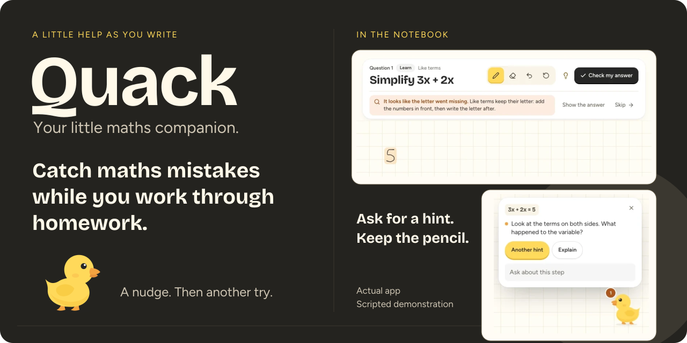
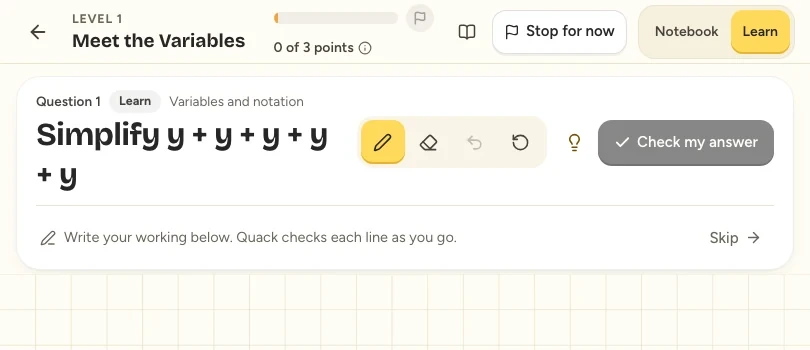
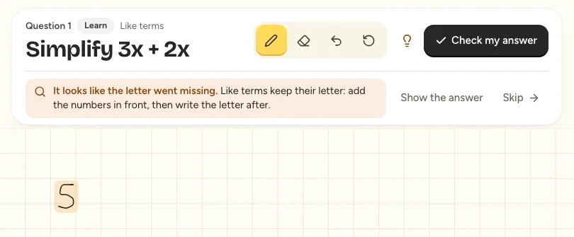
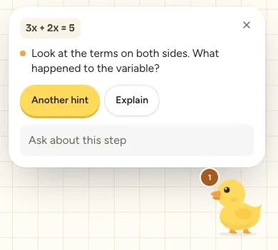
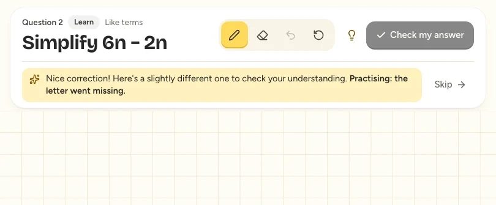
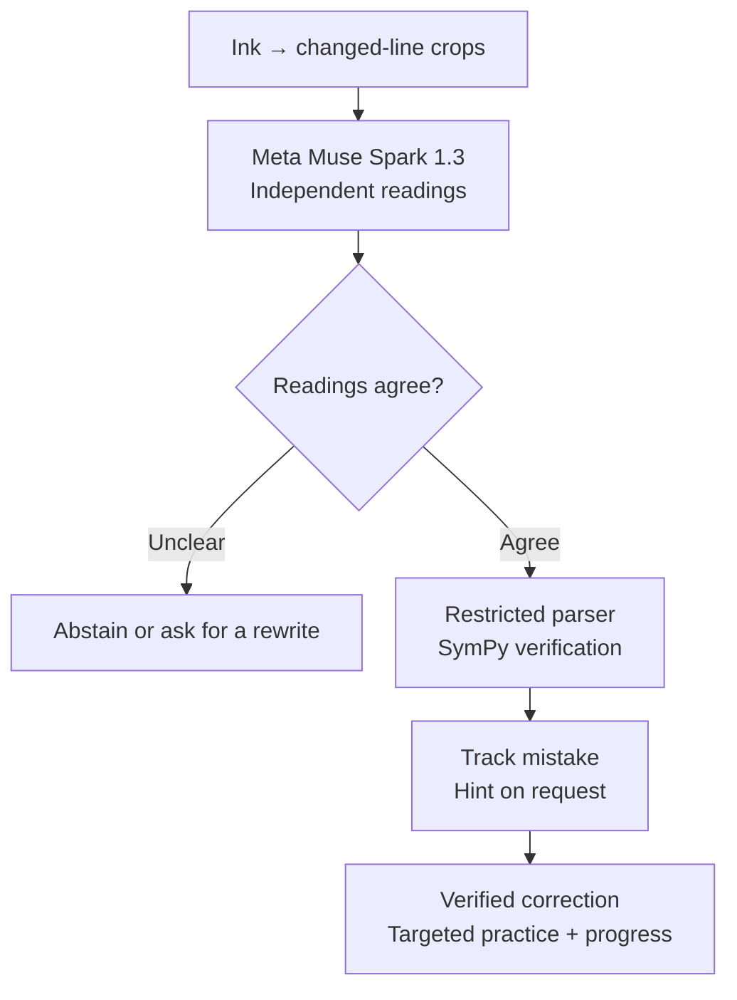

<a href="docs/media/hero.svg?v=2#gh-light-mode-only">
  <picture>
    <source media="(max-width: 600px)" srcset="docs/media/hero-mobile.svg" />
    
  </picture>
</a>
<a href="docs/media/hero-dark.svg#gh-dark-mode-only">
  <picture>
    <source media="(max-width: 600px)" srcset="docs/media/hero-mobile-dark.svg" />
    
  </picture>
</a>

<p align="center"><strong>Catch maths mistakes while you work through homework.</strong><br/>A handwriting-first AI maths tutor for primary and secondary school students.</p>
<p align="center"><a href="https://quack-amber-seven.vercel.app/">Try Quack</a> · <a href="#see-a-mistake-become-a-learning-moment">See the learning loop</a> · <a href="#how-quack-works">How it works</a> · <a href="#run-quack-locally">Run locally</a></p>

Write maths by hand. When Quack spots a mistake, it points to the line. Ask for a hint, fix it yourself, and keep going. Built for the **Meta Global AI Developer Hackathon 2026**.

## Why I built Quack

While tutoring primary and secondary school students, I saw the same thing again and again: they understood the maths when I sat beside them, but alone, one slip midway through a solution carried through every remaining line. Nobody noticed until the final answer, or our next lesson.

Quack brings that timely feedback into independent homework. Students write, ask for hints and correct their own work, so tutors and teachers are supported in the hours between lessons.

## Two ways to learn

**My Notebook.** Bring your own question and write freely. Quack checks your working and helps when you ask. Notes stay on your device.

**Learn with Quack.** Six learning paths, from arithmetic to introductory calculus, with short lessons and practice on the same handwriting canvas. Verified corrections lead to targeted practice and level progression.

<a href="docs/media/active-learning.webp"></a>

## See a mistake become a learning moment

**Write → Notice → Hint → Correct → Practise → Progress**

**1. Notice.** Asked to simplify `3x + 2x`, the student writes `5`. Quack flags the missing variable.

<a href="docs/media/mistake-feedback.webp"></a>

**2. Hint.** Tap the duck: *“Look at the terms on both sides. What happened to the variable?”* The first hint never gives the answer away; stronger help is there if needed.

<p align="center"><a href="docs/media/mistake-hint.webp"></a></p>

**3. Practise.** The student corrects it to `5x`. Quack verifies the fix and picks a related question, `6n − 2n`, to practise the same misconception.

<a href="docs/media/adaptive-follow-up.webp"></a>

<sub>Screenshots use the real app with scripted handwriting. [Full gallery and capture notes](docs/media/README.md).</sub>

## How Quack works

**The model reads handwriting. Code checks the mathematics.**



Meta's multimodal model interprets each changed line, and Quack takes independent readings. When they agree, a restricted parser and SymPy verify the maths deterministically. When they don't, Quack abstains or asks the student to rewrite rather than guess.

Most of the engineering lives between those stages: grouping freehand strokes into lines, preserving fractions, reconciling readings, discarding stale responses, spotting repeat mistakes, and telling a genuine correction apart from an ordinary edit. Symbolic checks run in killable processes, and timeouts and budgets bound model usage.

[Architecture](docs/ARCHITECTURE.md) · [Technical overview](docs/hackathon/TECHNICAL_OVERVIEW.md) · [Judge guide](docs/hackathon/JUDGE_GUIDE.md)

## Built with

| Layer | Technologies |
|---|---|
| Interface | Next.js 16, React 19, TypeScript, Tailwind CSS 4, perfect-freehand |
| API and maths | Python, FastAPI, Pydantic, SymPy |
| AI | Meta Model API (Muse Spark 1.3) for recognition, hints and explanations |
| Data | Supabase Auth and PostgreSQL (hosted), SQLite (local), IndexedDB (notes) |
| Hosting | Vercel (web), Modal (API) |
| Testing | Pytest, Vitest, Playwright, Ruff, ESLint |

## Run Quack locally

<details>
<summary><strong>Setup and test commands</strong></summary>

Requires Python 3.11+, Node.js 20.9+ and a [Meta Model API](https://dev.meta.ai) key (optional: without one you can explore the interface).

```bash
git clone https://github.com/Brendan-Lim/Quack.git
cd Quack
cp .env.example .env   # set MODEL_API_KEY, QUACK_ENV=development, QUACK_AUTH_MODE=local

# Terminal 1 — API
cd services/api
python3 -m venv .venv
.venv/bin/python -m pip install -r requirements-dev.txt
.venv/bin/uvicorn quack.main:create_app --factory --port 8000

# Terminal 2 — web app
cd apps/web
npm ci
npm run dev
```

Open `http://localhost:3000`, create a local test account and complete the six-sample handwriting calibration.

```bash
# Tests (use a fake Meta API; no key or credits needed)
(cd services/api && .venv/bin/pytest && .venv/bin/ruff check quack tests)
(cd apps/web && npm test && npx tsc --noEmit && npx playwright install chromium && npm run test:e2e)
```

Production builds, tablet access and account configuration: [setup guide](docs/SETUP.md) · [testing guide](docs/TESTING.md).

</details>

## Limitations

- Recognition accuracy hasn't been measured on a representative handwriting dataset or established on a physical iPad and Apple Pencil. Fractions, decimals and crossed-out working are the hardest cases.
- Quack checks a defined set of maths. Algebra is the most complete path; the other five are starter journeys.
- Handwriting crops are sent to Meta's API for recognition. Notes stay in your browser; learning history is stored in your account and can be exported or deleted.

## Credits

The duck is original artwork. Thanks to Meta for the multimodal API and to the maintainers of Next.js, React, FastAPI and SymPy. Built by Brendan Lim with AI coding assistance (Codex).

No open-source license has been selected yet; third-party components keep their own licenses ([credits and notices](docs/CREDITS.md)). More docs: [documentation index](docs/README.md).
