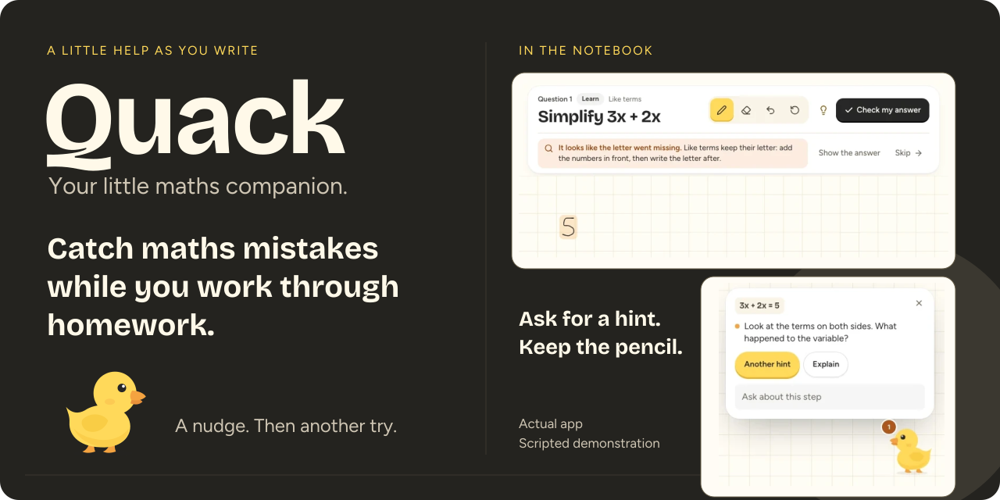
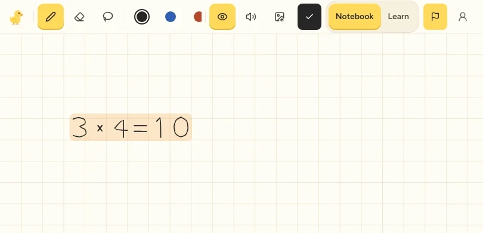
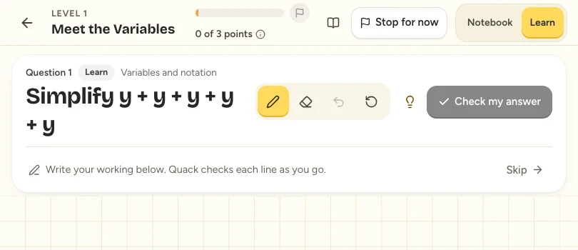
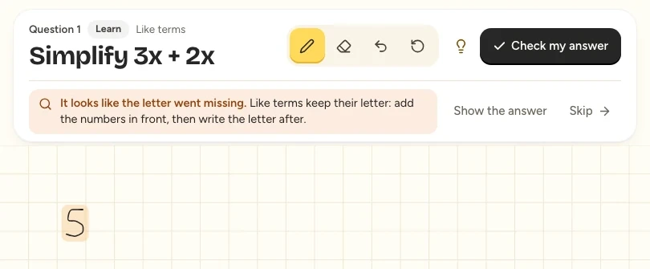
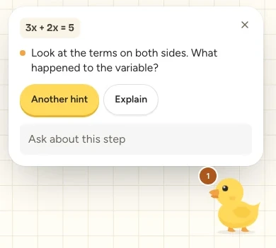
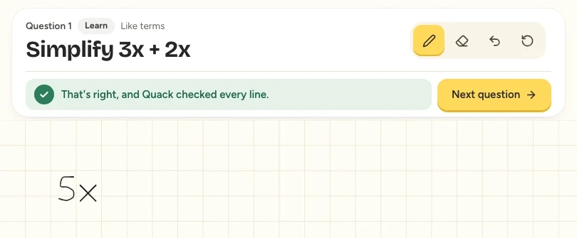
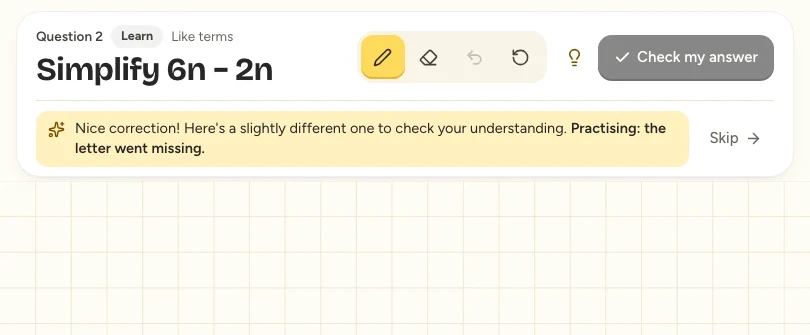
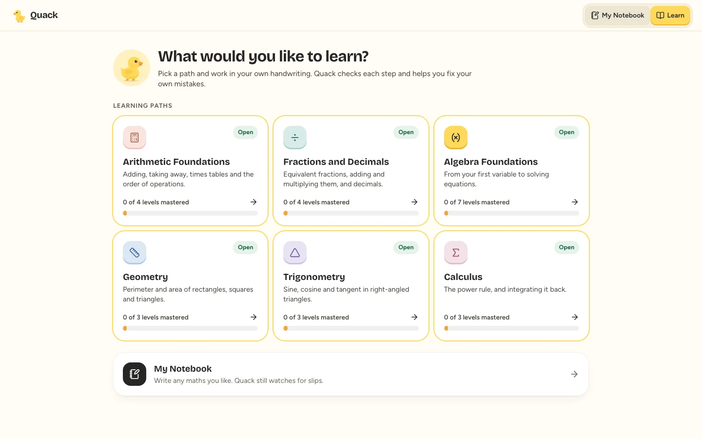
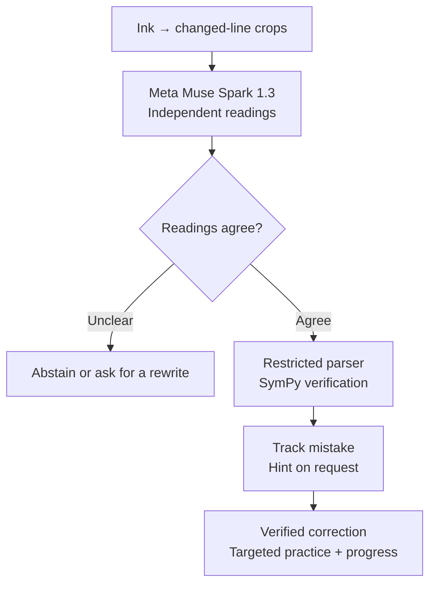

<a href="docs/media/hero.svg?v=2#gh-light-mode-only">
  <picture>
    <source media="(max-width: 600px)" srcset="docs/media/hero-mobile.svg" />
    
  </picture>
</a>
<a href="docs/media/hero-dark.svg#gh-dark-mode-only">
  <picture>
    <source media="(max-width: 600px)" srcset="docs/media/hero-mobile-dark.svg" />
    
  </picture>
</a>

<p align="center"><strong>Catch maths mistakes while you work through homework.</strong><br/>A handwriting-first AI maths tutor for primary and secondary school students.</p>
<p align="center"><a href="https://quack-amber-seven.vercel.app/">Try Quack</a> · <a href="#see-a-mistake-become-a-learning-moment">See the learning loop</a> · <a href="#how-quack-works">How it works</a> · <a href="#run-quack-locally">Run locally</a></p>

Write your own mathematics. When Quack identifies a supported mistake, it points to the line. Ask for a hint, make your own correction, and keep going. Built for the Meta Global AI Developer Hackathon 2026.

**In the public demo:** create an account, complete six handwriting samples, then choose **My Notebook** or **Learn**. Supabase accounts, PostgreSQL learning records and live Meta recognition are connected. The shared model allowance is limited; the backend may take a moment to wake after inactivity.

## Why I built Quack

While giving private tuition to primary and secondary school students, I noticed a gap between lessons and homework. Students often understood the maths when I sat beside them. Working alone, a mistake midway through a solution could carry through every remaining line, only coming to light at the final answer or our next lesson.

I built Quack to bring some of that timely feedback into independent homework. Students write, ask for hints and correct their own work. Quack supports teachers and tutors in the hours between lessons.

## Two ways to learn

### My Notebook

Bring your own question and write freely. Pen, eraser, undo and redo keep the page yours. Quack checks supported working and offers help when you ask. Notes stay on your device.

<a href="docs/media/notebook.webp"></a>

### Learn with Quack

Choose a path, read a short lesson and work through questions on the same handwriting canvas. Verified corrections lead to targeted practice and progression.

<a href="docs/media/active-learning.webp"></a>

*All product captures use the actual release UI, synthetic ink, isolated test accounts and scripted model readings. The API, verifier and learning flow are real. These images do not demonstrate live recognition, physical Apple Pencil accuracy or educational outcomes. Detail images are crops; select them to inspect the full captures. [Media provenance and full gallery](docs/media/README.md).*

## See a mistake become a learning moment

**Write → Notice → Hint → Correct → Practise → Progress**

### 1. A small slip, noticed while it matters

The question is **Simplify `3x + 2x`**. The student writes `5`, dropping the variable. With agreeing recognition readings and deterministic verification, Quack flags the missing letter.

<a href="docs/media/mistake-feedback.webp"></a>

### 2. A hint leaves the next step to the student

Tap the duck for help: “Look at the terms on both sides. What happened to the variable?” The first hint does not supply the answer. Stronger help is available when needed.

<p align="center"><a href="docs/media/mistake-hint.webp"></a></p>

### 3. The correction shapes what comes next

The student changes the answer to **`5x`**. Quack verifies the correction, then selects a related question: **`6n − 2n`**. Independent answers and assisted corrections earn different credit towards the next level.

<a href="docs/media/correction.webp"></a>

<a href="docs/media/adaptive-follow-up.webp"></a>

Quack checks a supported set of mathematics. When readings disagree or handwriting is unclear, it can abstain or ask you to rewrite. Two agreeing readings can still share a recognition error.

The adaptation policy is deterministic: verified mathematical events and named misconceptions select the next question. There is no separately trained recommendation model, and unclear handwriting is never evidence of a misconception.

<details>
<summary><strong>What else is built?</strong></summary>

- **Automatic checks and corrections:** line-based alerts, highlights, stale-reply protection and a lifecycle that distinguishes editing from a verified fix.
- **A hint ladder:** a nudge, a stronger hint and an explanation, checked so they don't leak the answer too early.
- **Circle-to-Ask:** circle supported working to ask for checking or an explanation of its rule.
- **Learning history:** My Mistakes, verified corrections, targeted practice, session recaps and returning-student continuation.
- **Mastery progression:** independent answers and assisted corrections earn different credit; levels unlock through progression rules.
- **Handwriting calibration:** six writer-specific samples can provide extra recognition context. An accuracy benefit has not been established.
- **Uncertainty handling:** disputed or unclear readings can lead to abstention or a request to rewrite.

</details>

<details>
<summary><strong>Six learning paths, the guided canvas and progression</strong></summary>



| Path | What you can practise | Levels, including its challenge |
|---|---|---:|
| Arithmetic Foundations | Addition, subtraction, multiplication, division and order of operations | 4 |
| Fractions & Decimals | Equivalent fractions, fraction operations and decimal conversions | 4 |
| **Algebra Foundations** | Variables, substitution, like terms, expressions, brackets and linear equations | **7** |
| Geometry | Numerical perimeter and area problems, presented in words | 3 |
| Trigonometry | Right-triangle ratios and supported common-angle values in degrees | 3 |
| Calculus | Introductory power-rule differentiation and integration | 3 |

Algebra is the most developed journey. The other five are **playable starter journeys**, adding 12 regular levels, five mastery challenges and 37 question templates. They are focused learning paths, not full subject or national curriculum coverage. The [versioned catalog](services/api/quack/curriculum/catalog.v1.json) is the source of truth.

The original duck has checking, hint and celebration states, with optional browser-generated sound. It checks quietly and quacks once on a newly verified mistake.

[Guided canvas](docs/media/active-learning.webp) · [Algebra roadmap](docs/media/algebra-roadmap.webp) · [Mastery celebration](docs/media/level-mastered.webp) · [My Mistakes](docs/media/my-mistakes.webp)

</details>

## How Quack works

The model reads handwriting. Code checks the mathematics.



**Reading and checking are different jobs.** Meta's multimodal model interprets the image. Python's restricted parser and SymPy check supported mathematics. The verifier cannot know what was physically written without recognition evidence; two agreeing readings can still share a mistake.

The engineering sits between these stages: grouping freehand strokes into lines, preserving fractions, tracking mathematical task context, reconciling readings, ignoring stale responses, identifying repeat mistakes and recognising a correction without treating every edit as success. Identical in-flight readings are shared, settled lines are remembered, and timeouts and budgets bound model work. Symbolic jobs run in killable processes. [Architecture](docs/ARCHITECTURE.md) · [Verification boundaries](docs/ARCHITECTURE.md#verification-boundaries) · [Technical overview](docs/hackathon/TECHNICAL_OVERVIEW.md).

## Built with

| Layer | Technologies |
|---|---|
| Interface | Next.js 16, React 19, TypeScript, Tailwind CSS 4, perfect-freehand, Lucide |
| API and mathematics | Python, FastAPI, Pydantic, restricted parser, SymPy, Pillow |
| Meta models | Meta Model API with Muse Spark 1.3 for handwriting recognition, hints and explanations; no model training or fine-tuning |
| Optional Meta paths | Muse Voice Transcribe 1.0 has an implemented transcription path, and Muse Wonder 1.0 can be selected through route configuration. Neither is presented as verified live production inference. |
| Accounts and storage | Supabase Auth and PostgreSQL on the hosted app, SQLite locally, IndexedDB for device-local notes |
| Hosting | Vercel for the web app, Modal for the API |
| Verification | Pytest, Vitest, Playwright, Ruff, ESLint and TypeScript |

## Run Quack locally

<details>
<summary><strong>Setup, test commands and production requirements</strong></summary>

Use Python **3.11+** (3.12 recommended), Node.js **20.9+**, npm, and a Meta Model API key from [Meta for Developers](https://dev.meta.ai). The Python verifier requires a platform supporting `multiprocessing`'s `forkserver`, such as macOS or Linux.

```bash
git clone https://github.com/Brendan-Lim/Quack.git
cd Quack
cp .env.example .env
```

Edit `.env`: set `MODEL_API_KEY`, `QUACK_ENV=development` and `QUACK_AUTH_MODE=local` for clearly labelled local test accounts and all learning features. Set explicit `QUACK_BUDGET_*` ceilings appropriate to your actual allowance; real recognition uses API credit. Leave the key blank to explore the interface without recognition. Automated suites use a fake Meta API and require no real key.

```bash
# Terminal 1 — from the repository root
cd services/api
python3 -m venv .venv
.venv/bin/python -m pip install -r requirements-dev.txt
.venv/bin/uvicorn quack.main:create_app --factory --port 8000

# Terminal 2 — from the repository root
cd apps/web
npm ci
npm run dev
```

Open `http://localhost:3000`, create a local test account and complete calibration. Choose **My Notebook** or **Learn**. `QUACK_AUTH_MODE=off` provides an account-free notebook. Production learning accounts require Supabase configuration; local test accounts are refused outside development. See [.env.example](.env.example) and [account setup](docs/SETUP.md#accounts).

For a tablet on your local network, start Next with `npm run dev -- --hostname 0.0.0.0` and open `http://<computer-lan-address>:3000`. The API can stay bound to localhost because Next proxies requests. Microphone features need HTTPS or localhost.

```bash
# Backend, from services/api — excludes paid live tests by default
.venv/bin/pytest
.venv/bin/ruff check quack tests

# Frontend, from apps/web
npm test
npx eslint .
npx tsc --noEmit
npx playwright install chromium
npm run test:e2e
npm run build
```

Browser suites start isolated APIs, databases and a fake Meta server. If their ports are occupied, use `QUACK_E2E_PORT_SHIFT=1000 npm run test:e2e`. Live evaluations are separate and consume credits. The default test commands use synthetic data and mocked inference; see [testing](docs/TESTING.md).

**Production build:** set `API_URL` when building, for example `API_URL=https://your-api-host npm run build`, then `npm start`. Next proxies `/api/*`; this requires a Next server with rewrite support. Static-only hosting does not support the current configuration. [Server requirements](docs/SETUP.md#server-requirements).

</details>

## Current limits

Automated coverage exercises the parser, symbolic verifier, correction lifecycle, question selection, account boundaries and browser journeys. Run the suites with the commands above; [testing documentation](docs/TESTING.md) explains which layers use a fake model and what the results can establish.

- Synthetic tests do not establish physical iPad or Apple Pencil accuracy. Fraction bars, decimal points, degree signs, calculus notation, crossed-out working and ambiguous characters remain recognition risks.
- Recognition accuracy has not been established on a representative handwriting dataset. A brief alert on an unfinished line remains possible. Quack does not guarantee zero false positives.
- Geometry has word problems, without diagrams. Trigonometry excludes surds and undefined values; some wrong exact-value work remains uncertain rather than producing an alert.
- Calibration's recognition benefit and educational effectiveness have not been established through controlled studies.
- Hosted Supabase registration, sign-in, session refresh and account isolation have been checked. Live Meta recognition was smoke-tested with synthetic pointer-drawn ink for an Algebra mistake and correction; this does not establish general recognition accuracy. Live checking state is in one API process. Notes stay on the device; accounts sync learning records, not notebooks.

## Your writing and your data

When checking is enabled or requested, recent-line image crops go to Meta's API. Account calibration can add samples from that same writer. Notes stay in the browser's IndexedDB; calibration and learning history live in the account database. Settings supports export and deletion. Model keys stay on the backend. Budget ledgers must be stored privately and durably. Quack has not been assessed against education-specific privacy requirements. [Account and storage boundaries](docs/ARCHITECTURE.md#accounts-and-storage).

## Explore the project

| For product reviewers | For developers |
|---|---|
| [Judge guide](docs/hackathon/JUDGE_GUIDE.md) | [Architecture](docs/ARCHITECTURE.md) |
| [Technical overview](docs/hackathon/TECHNICAL_OVERVIEW.md) | [Setup and account configuration](docs/SETUP.md) |
| [Screenshot gallery](docs/media/README.md) | [Tests and reproducibility](docs/TESTING.md) |
| [Documentation index](docs/README.md) | [Public-file policy](docs/PUBLICATION.md) |

## Credits and licensing

Quack's duck is an original SVG in this project. The banner reuses that artwork. Thanks to Meta for the multimodal API and to the maintainers of Next.js, React, FastAPI, SymPy and the other dependencies. Figtree and Bricolage Grotesque provide the app's typography. Development was AI-assisted, including coding, testing and release preparation with Codex.

No project-wide open-source license has been selected. Public source availability does not grant an additional license. Third-party components retain their own licenses; see [credits and notices](docs/CREDITS.md).
