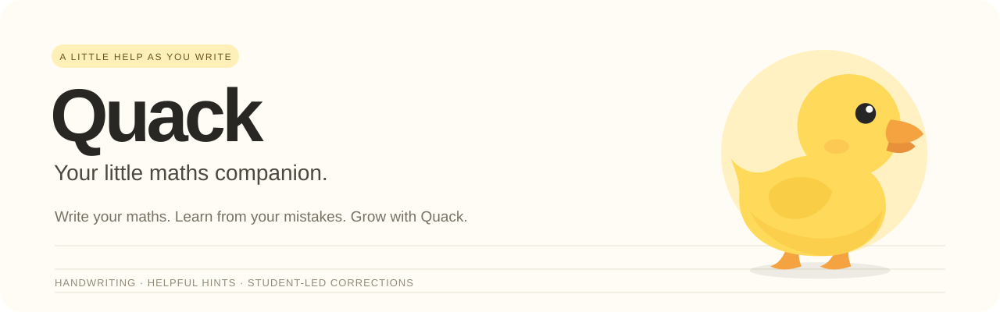
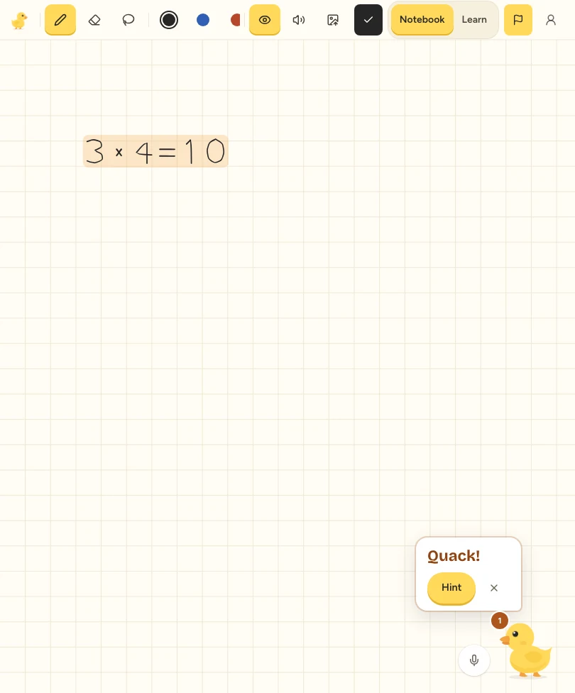
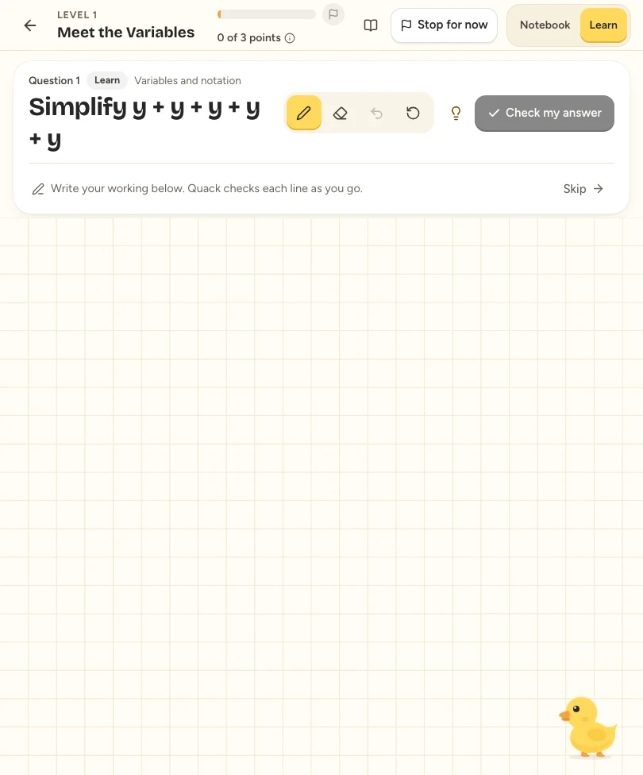
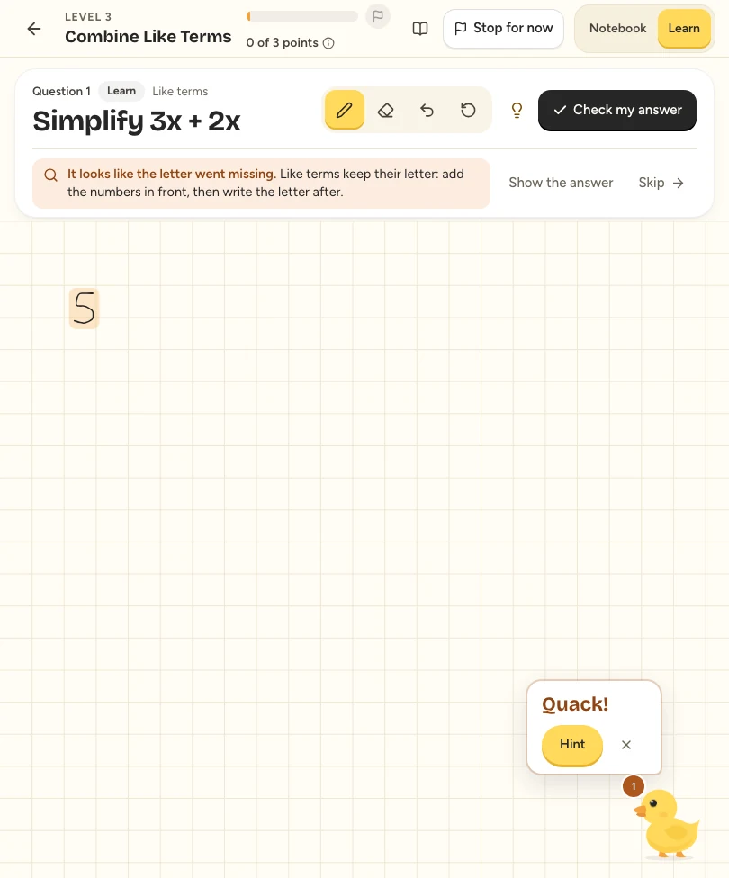
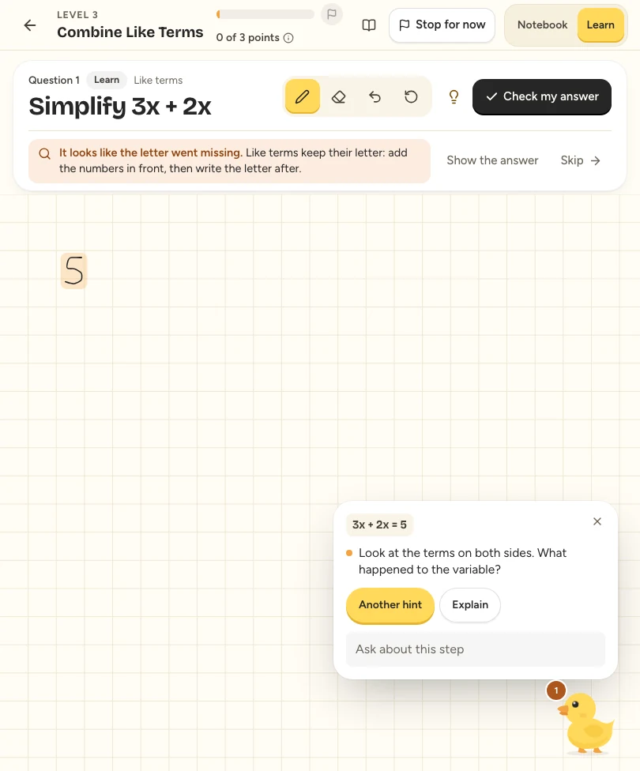
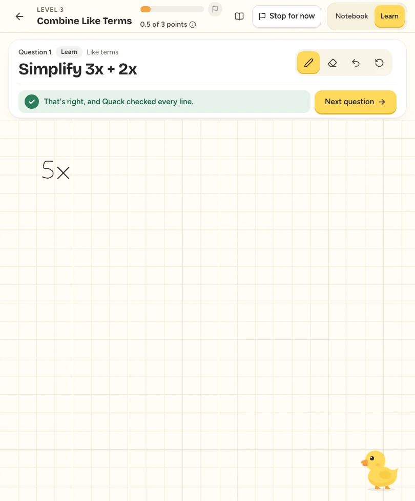
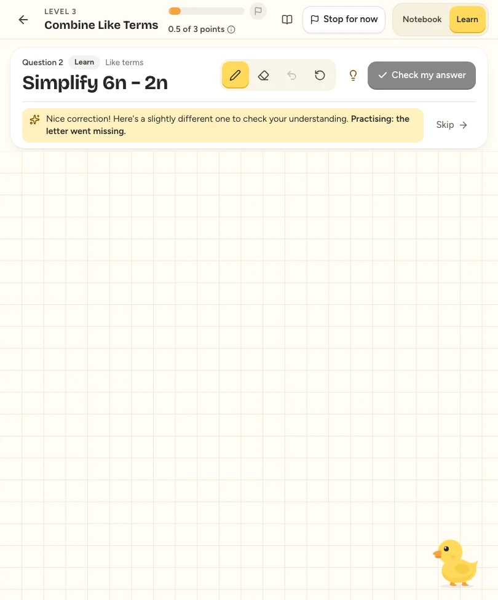
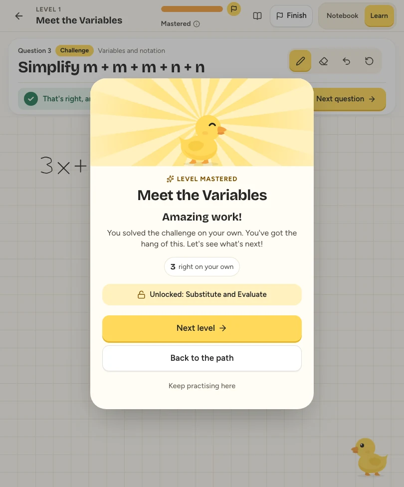
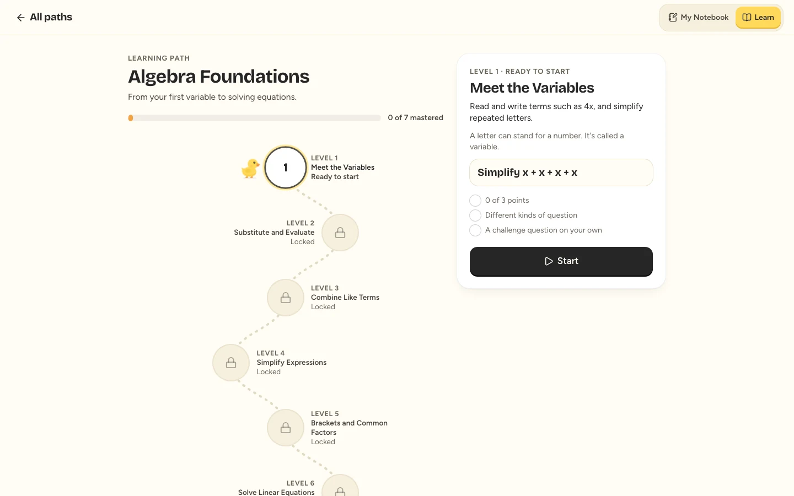
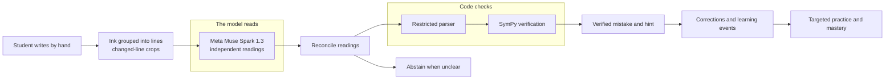

<p align="center"></p>

<h1 align="center">Quack</h1>
<h3 align="center">Your little maths companion.</h3>
<p align="center">A handwriting-first AI maths tutor that helps students catch mistakes while doing homework.</p>
<p align="center">Built for the Meta Global AI Developer Hackathon 2026<br/>Meta Muse Spark · SymPy · Next.js · FastAPI</p>
<p align="center"><a href="https://quack-amber-seven.vercel.app">Try Quack</a> · <a href="#how-quack-works">How it works</a> · <a href="docs/hackathon/JUDGE_GUIDE.md">Judge guide</a> · <a href="#run-quack-locally">Run locally</a></p>

Meet Quack, a friendly little duck that helps you learn maths as you write. Work through a problem in your own handwriting. When Quack is confident it has found a supported mistake, it points to that line, gently. Ask for a hint, try a correction, and keep going. It is made for primary and secondary school students doing homework and revision on their own.

**[Open the public demo](https://quack-amber-seven.vercel.app).** Create your own account, complete six handwriting samples and choose **Learn** or **My Notebook**. The demo uses Supabase accounts and PostgreSQL learning records, with live Meta recognition. Its shared model allowance is limited, and the backend may take a moment to wake after inactivity.

## Why I built Quack

I've done private tuition for primary and secondary school students. When I sat beside a student, they usually understood the maths, because I could correct a mistake as they made it. Homework is different. Nobody is there, so a slip in an early step gets carried through every line after it. The student finds out at the final answer, or when we go through the homework at the next lesson.

I wanted independent homework to have a little of what makes tuition work: someone noticing where it went wrong while there is still a chance to fix it.

Students this age do maths by writing, so Quack works from handwriting instead of asking them to type equations into a chatbot. It checks supported working, offers a hint rather than the answer, and leaves the correction to the student. It is meant for the hours when a teacher or tutor is not there, and it does not replace one.

## Two ways to learn

**My Notebook** is for your own questions. Write freely, with pen, eraser, undo and redo. Quack checks supported working, highlights a relevant line and offers help when you ask. Notes stay on your device.

**Learn with Quack** is guided. Choose a path, read a short lesson, follow a worked example and solve questions on the same handwriting canvas. Verified work feeds targeted practice and mastery progression, so you unlock levels as you go.

<p align="center">
  
  
</p>

Learn reuses the notebook's ink and verification pipeline. You work through the mathematics yourself, with room for intermediate steps.

## Write → notice → hint → correct → practise → progress

This is the loop Quack is built around. Here it is in the guided question **Simplify `3x + 2x`**:

1. **Write.** The student writes `5`, dropping the variable.
2. **Notice.** With agreeing readings and deterministic verification, Quack flags the line: "It looks like the letter went missing."
3. **Hint.** Ask for help and the duck asks "What happened to the variable?" without supplying the answer.
4. **Correct.** The student changes it to `5x` and Quack verifies the change.
5. **Practise.** A follow-up on the same skill comes next, here `6n − 2n`.
6. **Progress.** Independent answers and assisted corrections earn different credit towards the next level.

<p align="center">
  
  
  
  
</p>

*Screenshots show the actual release UI with synthetic ink, isolated test accounts and scripted model readings. The API, verifier and learning flow are real; these captures do not demonstrate live Meta recognition or physical Apple Pencil accuracy. [Media provenance](docs/media/README.md).*

Quack does not catch every mistake. It covers a supported set, and when readings disagree or the handwriting is unclear it can ask you to rewrite instead of guessing.

The current adaptation policy is deterministic. It picks the next question from verified mathematical events and named misconceptions, and there is no separately trained recommendation model. Unclear handwriting is never treated as evidence of a misconception.

<details>
<summary><strong>What else is built?</strong></summary>

- **Automatic checks and corrections:** line-based alerts, highlights, stale-reply protection and a lifecycle that distinguishes editing from a verified fix.
- **A hint ladder:** a nudge, a stronger hint and an explanation, checked so they don't leak the answer too early.
- **Circle-to-Ask:** circle supported working to ask for checking or an explanation of its rule.
- **Learning history:** My Mistakes, verified corrections, targeted practice, session recaps and returning-student continuation.
- **Mastery progression:** independent answers and assisted corrections earn different credit; levels unlock through progression rules.
- **Handwriting calibration:** six writer-specific samples can provide extra recognition context. An accuracy benefit has not been established.
- **Uncertainty handling:** disputed or unclear readings can lead to abstention or a request to rewrite.

</details>

## A companion with a little personality

<p align="center"></p>

Quack checks quietly, quacks on a newly verified mistake, offers encouragement when you ask for help and celebrates accepted answers and mastered levels. The original SVG duck has animated checking, hint and celebration states, with optional browser-generated sound cues.

<p align="center"></p>

## Six playable learning paths


| Path | What you can practise | Levels, including its challenge |
|---|---|---:|
| Arithmetic Foundations | Addition, subtraction, multiplication, division and order of operations | 4 |
| Fractions & Decimals | Equivalent fractions, fraction operations and decimal conversions | 4 |
| **Algebra Foundations** | Variables, substitution, like terms, expressions, brackets and linear equations | **7** |
| Geometry | Numerical perimeter and area problems, presented in words | 3 |
| Trigonometry | Right-triangle ratios and supported common-angle values in degrees | 3 |
| Calculus | Introductory power-rule differentiation and integration | 3 |

Algebra is the most developed journey. The other five are **playable starter journeys**, adding 12 regular levels, five mastery challenges and 37 question templates. They are focused learning paths, not full subject or national curriculum coverage. The [versioned catalog](services/api/quack/curriculum/catalog.v1.json) is the source of truth.



## How Quack works



**Reading and checking are different jobs.** Meta's multimodal model interprets the image. Python's restricted parser and SymPy check supported mathematics. The verifier cannot know what was physically written without recognition evidence; two agreeing readings can still share a mistake.

The engineering sits between these stages: grouping freehand strokes into lines, preserving fractions, tracking mathematical task context, reconciling readings, ignoring stale responses, identifying repeat mistakes and recognising a correction without treating every edit as success. Identical in-flight readings are shared, settled lines are remembered, and timeouts and budgets bound model work. Symbolic jobs run in killable processes. [Architecture](docs/ARCHITECTURE.md) · [Verification boundaries](docs/ARCHITECTURE.md#verification-boundaries) · [Technical overview](docs/hackathon/TECHNICAL_OVERVIEW.md).

## Built with

| Layer | Technologies |
|---|---|
| Interface | Next.js 16, React 19, TypeScript, Tailwind CSS 4, perfect-freehand, Lucide |
| API and mathematics | Python, FastAPI, Pydantic, restricted parser, SymPy, Pillow |
| Meta models | Meta Model API with Muse Spark 1.3 for handwriting recognition, hints and explanations; no model training or fine-tuning |
| Optional Meta paths | Muse Voice Transcribe 1.0 has an implemented transcription path, and Muse Wonder 1.0 can be selected through route configuration. Neither is presented as verified live production inference. |
| Accounts and storage | Supabase Auth and PostgreSQL on the hosted app, SQLite locally, IndexedDB for device-local notes |
| Hosting | Vercel for the web app, Modal for the API |
| Verification | Pytest, Vitest, Playwright, Ruff, ESLint and TypeScript |

## Run Quack locally

Use Python **3.11+** (3.12 recommended), Node.js **20.9+**, npm, and a Meta Model API key from [Meta for Developers](https://dev.meta.ai). The Python verifier requires a platform supporting `multiprocessing`'s `forkserver`, such as macOS or Linux.

```bash
git clone https://github.com/Brendan-Lim/Quack.git
cd Quack
cp .env.example .env
```

Edit `.env`: set `MODEL_API_KEY`, `QUACK_ENV=development` and `QUACK_AUTH_MODE=local` for clearly labelled local test accounts and all learning features. Set explicit `QUACK_BUDGET_*` ceilings appropriate to your actual allowance; real recognition uses API credit. Leave the key blank to explore the interface without recognition. Automated suites use a fake Meta API and require no real key.

```bash
# Terminal 1 — from the repository root
cd services/api
python3 -m venv .venv
.venv/bin/python -m pip install -r requirements-dev.txt
.venv/bin/uvicorn quack.main:create_app --factory --port 8000

# Terminal 2 — from the repository root
cd apps/web
npm ci
npm run dev
```

Open `http://localhost:3000`, create a local test account and complete calibration. Choose **My Notebook** or **Learn**. `QUACK_AUTH_MODE=off` provides an account-free notebook. Production learning accounts require Supabase configuration; local test accounts are refused outside development. See [.env.example](.env.example) and [account setup](docs/SETUP.md#accounts).

For a tablet on your local network, start Next with `npm run dev -- --hostname 0.0.0.0` and open `http://<computer-lan-address>:3000`. The API can stay bound to localhost because Next proxies requests. Microphone features need HTTPS or localhost.

```bash
# Backend, from services/api — excludes paid live tests by default
.venv/bin/pytest
.venv/bin/ruff check quack tests

# Frontend, from apps/web
npm test
npx eslint .
npx tsc --noEmit
npx playwright install chromium
npm run test:e2e
npm run build
```

Browser suites start isolated APIs, databases and a fake Meta server. If their ports are occupied, use `QUACK_E2E_PORT_SHIFT=1000 npm run test:e2e`. Live evaluations are separate and consume credits. The default test commands use synthetic data and mocked inference; see [testing](docs/TESTING.md).

**Production build:** set `API_URL` when building, for example `API_URL=https://your-api-host npm run build`, then `npm start`. Next proxies `/api/*`; this requires a Next server with rewrite support. Static-only hosting does not support the current configuration. [Server requirements](docs/SETUP.md#server-requirements).

## Current limits

Automated coverage exercises the parser, symbolic verifier, correction lifecycle, question selection, account boundaries and browser journeys. Run the suites with the commands above; [testing documentation](docs/TESTING.md) explains which layers use a fake model and what the results can establish.

- Synthetic tests do not establish physical iPad or Apple Pencil accuracy. Fraction bars, decimal points, degree signs, calculus notation, crossed-out working and ambiguous characters remain recognition risks.
- Recognition accuracy has not been established on a representative handwriting dataset. A brief alert on an unfinished line remains possible. Quack does not guarantee zero false positives.
- Geometry has word problems, without diagrams. Trigonometry excludes surds and undefined values; some wrong exact-value work remains uncertain rather than producing an alert.
- Calibration's recognition benefit and educational effectiveness have not been established through controlled studies.
- Hosted Supabase registration, sign-in, session refresh and account isolation have been checked. Live Meta recognition was smoke-tested with synthetic pointer-drawn ink for an Algebra mistake and correction; this does not establish general recognition accuracy. Live checking state is in one API process. Notes stay on the device; accounts sync learning records, not notebooks.

## Your writing and your data

When checking is enabled or requested, recent-line image crops go to Meta's API. Account calibration can add samples from that same writer. Notes stay in the browser's IndexedDB; calibration and learning history live in the account database. Settings supports export and deletion. Model keys stay on the backend. Budget ledgers must be stored privately and durably. Quack has not been assessed against education-specific privacy requirements. [Account and storage boundaries](docs/ARCHITECTURE.md#accounts-and-storage).

## Explore the project

| For product reviewers | For developers |
|---|---|
| [Judge guide](docs/hackathon/JUDGE_GUIDE.md) | [Architecture](docs/ARCHITECTURE.md) |
| [Technical overview](docs/hackathon/TECHNICAL_OVERVIEW.md) | [Setup and account configuration](docs/SETUP.md) |
| [Screenshot gallery](docs/media/README.md) | [Tests and reproducibility](docs/TESTING.md) |
| [Documentation index](docs/README.md) | [Public-file policy](docs/PUBLICATION.md) |

The source can also be run locally using the instructions above.

## Credits and licensing

Quack's duck is an original SVG in this project. The banner reuses that artwork. Thanks to Meta for the multimodal API and to the maintainers of Next.js, React, FastAPI, SymPy and the other dependencies. Figtree and Bricolage Grotesque provide the app's typography. Development was AI-assisted, including coding, testing and release preparation with Codex.

No project-wide open-source license has been selected. Public source availability does not grant an additional license. Third-party components retain their own licenses; see [credits and notices](docs/CREDITS.md).
