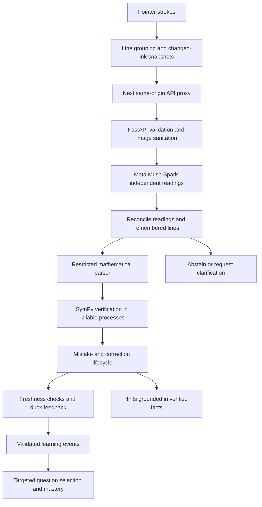

# Quack architecture

Quack separates three questions: what was written, whether the mathematics is supported and correct, and whether there is enough evidence to interrupt the student.

## Ink and model recognition

The Next.js/React frontend captures pointer strokes and renders them with `perfect-freehand`. `apps/web/lib/lines.ts` groups strokes by geometry and writing order, including stacked fractions. `snapshot.ts` renders changed lines and relevant neighbouring context on white, without paper ruling.

The scheduler waits for a pen-up pause and limits concurrent checks. The browser sends notebook version and line identities with the image. Next proxies `/api/*` to FastAPI. Pillow validates and re-encodes images before model use.

`services/api/quack/llm/router.py` owns calls to Meta Muse Spark 1.3. The model returns structured line readings, legibility and alternatives. It does not authorise mathematical alerts. Independent readings normally run in parallel, and their results are reconciled before a mistake or correction is confirmed. Repeated in-flight work can be shared; settled lines can be remembered. Conflicting readings can make a line uncertain.

## Verification boundaries

`math_parser.py` uses a restricted tokenizer and recursive-descent parser. Model text never reaches `eval` or `sympify`. Limits bound input length, tokens, depth, nodes and powers. The resulting AST is converted to SymPy nodes explicitly.

`math_verifier.py` checks supported arithmetic, expressions, equations, derivatives and integrals. Expression transitions and equation solution sets use different rules. Integrals are checked by differentiating an answer back. Answer completion can require a form, such as lowest terms, a decimal or an integration constant.

Context matters: `3x + 2x = 5` can be an incorrect simplification or an equation to solve. Lessons supply explicit question context; the notebook can ask about intent. The verifier abstains on unsupported or ambiguous claims rather than treating uncertainty as a mistake.

`verifier_pool.py` runs symbolic work in killable `forkserver` subprocesses with two concurrent slots. The default job timeout is four seconds after startup, with a separate startup allowance. Resource limits are applied where supported. Failure or timeout leads to abstention.

Mathematical verification depends on recognition evidence. Two agreeing readings can still share a misreading, so this architecture does not guarantee zero false positives or perfect recognition.

## Corrections and feedback

A line identity follows its current strokes; a mistake identity follows the mathematical claim. Editing a flagged line holds the alert and marks prior help as belonging to the old ink. Erasing the whole line is not itself a verified correction.

`mistake_manager.py` tracks new, repeated, held and resolved mistakes. `freshness.ts` checks whether the response still applies to the current ink. Stale replies and duplicate alerts are handled separately. A correction must be supported by agreeing readings of the relevant working before it is celebrated.

`hint_engine.py` supplies escalating help from verified facts. Deterministic hints and generated wording are checked for fidelity and premature answer disclosure. Circle-to-Ask reuses the checking rules for selected working.

## Guided and adaptive learning

The guided lesson uses the same notebook and checking pipeline. The versioned curriculum contains six available courses and 24 levels, including final challenges. Algebra has the deepest progression; the other five are starter journeys with 37 question templates.

Generated answer keys are verified before questions are shown. `learning.py` validates learning events against backend evidence. `misconceptions.py` and `adaptive.py` use supported mathematical patterns to select a follow-up question. The selection policy is deterministic, with no separately trained recommendation model. Uncertain recognition is not a verified misconception.

Independent completion earns one credit and assisted completion earns half. Distinct question types and skills contribute to mastery. Saved progress, My Mistakes and recaps support returning learners.

## Accounts and storage

Notes remain in the browser's IndexedDB, keyed by account. Calibration samples, study sessions, mistake facts, learning events and progression are stored server-side, using SQLite locally or PostgreSQL through Psycopg. Notebook notes do not synchronise across devices; account learning records can.

Supabase Auth provides the production identity path. The backend validates issuer, audience, expiry and allowed signing algorithms, then scopes account data by the verified subject. PostgreSQL tables enable row-level security with no public policies; application data access is through the backend. Local test accounts are labelled and refused outside development.

Calibration retains account-specific handwriting samples and can include them as recognition context. Transient notebook crops are not retained as image files. Settings supports export and deletion. Recognition benefits from calibration and educational effectiveness have not been established in controlled studies.

## Usage and hosting constraints

ModelRouter checks per-request, per-session, hourly and project ceilings and appends usage to a private durable ledger. Request-body and schema limits bound inputs. Per-client and global rate limiters protect spending routes. Budgets must reflect an actual available allowance.

Session state, reading caches and rate limits are in memory. Operate one API process/replica unless distributed coordination is implemented. Database persistence does not also persist the ledger. The backend needs subprocess support and durable writable storage; static-only hosting cannot implement Next's current API rewrites. See [setup](SETUP.md) and [testing](TESTING.md).
