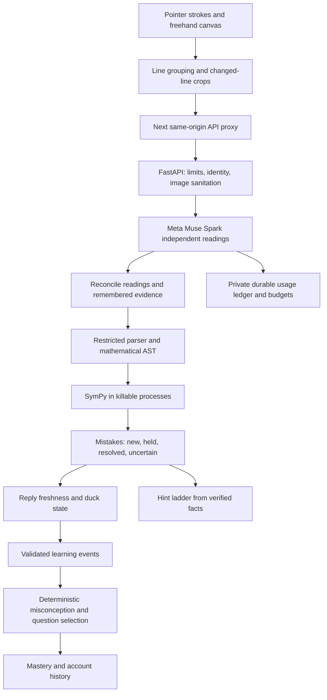

# Quack: from ink to a useful next question

The model reads; the deterministic verifier checks; the application decides when evidence warrants interrupting a student.

## Ink, recognition and context

`apps/web/lib/ink.ts`, `lines.ts` and `snapshot.ts` maintain strokes, group lines and rasterise changed ink on white. Geometry and writing order help preserve fractions and separate problems. The scheduler waits for pen-up pauses and bounds concurrent work. Freshness checks compare current ink with the snapshot before applying a reply.

FastAPI sanitises images with Pillow. `quack/llm/router.py` owns model requests. Muse Spark 1.3 returns structured text, legibility and alternatives, rather than authority to declare a mistake. Independent readings ordinarily run in parallel. Identical in-flight work can be shared; settled lines are remembered; conflicting remembered readings can be contested. A timeout fallback has stricter agreement requirements. Uncertainty can prevent an alert or an acceptance.

Task context matters. Simplifying, solving and substituting a given value need different checks. Guided questions supply deterministic context. The notebook can ask instead of guessing. A near-copy of a guided question's first line can be skipped under a narrowly bounded restatement rule; the actual question remains the reference.

## Verification and corrections

`math_parser.py` uses a tokenizer and restricted AST; model text never reaches `eval` or `sympify`. Limits constrain length, depth, tokens and powers. `math_verifier.py` checks supported arithmetic, expression transitions, solution sets, derivatives and integrals. Completion can also require a form, such as lowest terms, a decimal or an integration constant.

`verifier_pool.py` uses `forkserver` subprocesses, two concurrent slots, a four-second default job timeout after startup and resource limits where supported. A stuck job is killed and the system abstains.

Mistake identity is separate from line identity. Editing holds an old alert and marks help as belonging to prior ink. Erasure alone is not a correction. A verified fix needs agreement across readings and must apply to the relevant problem. Duplicate alerts and stale replies are separate concerns, so an unseen stale alert cannot consume the only notification.

## Hints, adaptation and mastery

`hint_engine.py` provides escalating help grounded in verified facts. Some help is deterministic; generated wording is checked for fidelity and spoilers. Circle-to-Ask uses the same checking rules and does not create a learning event merely because a region was circled.

`learning.py` validates client learning events against backend evidence. `misconceptions.py` and `adaptive.py` identify supported patterns and select follow-up templates. Answer keys must pass verification before a question is shown. Uncertainty cannot independently establish a misconception.

The catalog has six courses and 24 levels including six final challenges. Five newer courses add 37 templates. Independent completion earns one credit; assisted completion earns half. Distinct templates and skills contribute to mastery, and saved progress supports resuming. No recommendation model is trained.

## Persistence and account boundaries

Notes are in device-local IndexedDB, scoped by account key. SQLite is the local server default; PostgreSQL is supported via Psycopg. Server records include calibration samples, sessions, mistake facts, events, questions and progress. The application retains account calibration images, although transient notebook crops are not retained as server image files.

Supabase Auth is the production identity provider. The backend validates issuer, audience, expiry and allowed signing algorithms, then scopes data by the verified subject. PostgreSQL tables enable row-level security with no public policies; application access runs through the backend. Development local accounts are refused outside development. Hosted Supabase operation still needs verification.

## Usage protection and deployment

All model calls pass through `ModelRouter`, with request, session, hourly and project ceilings and a private append-only ledger. Body and schema limits constrain inputs. Rate limits apply per client and globally. Defaults do not establish that usage is free. Keep the ledger durable and choose ceilings for the actual account allowance.

Use one API process initially: sessions, caches and rate limits are not distributed. Next proxies `/api/*` using `API_URL` fixed at build time. The backend needs a writable ledger location and subprocess support. Durable PostgreSQL alone does not persist the ledger. Static-only hosting or subprocess-restricted functions do not satisfy this architecture. See [server requirements](../SETUP.md#server-requirements) and the [full architecture](../ARCHITECTURE.md).
