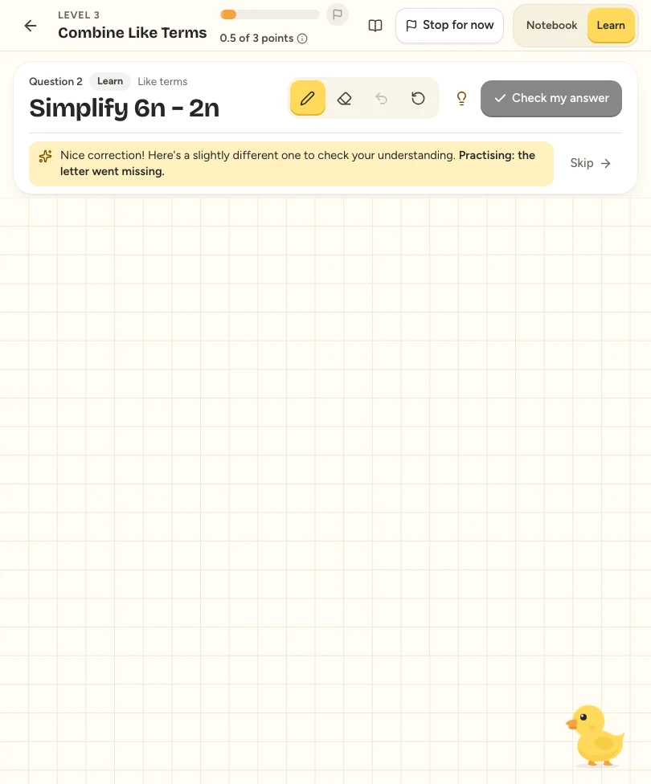
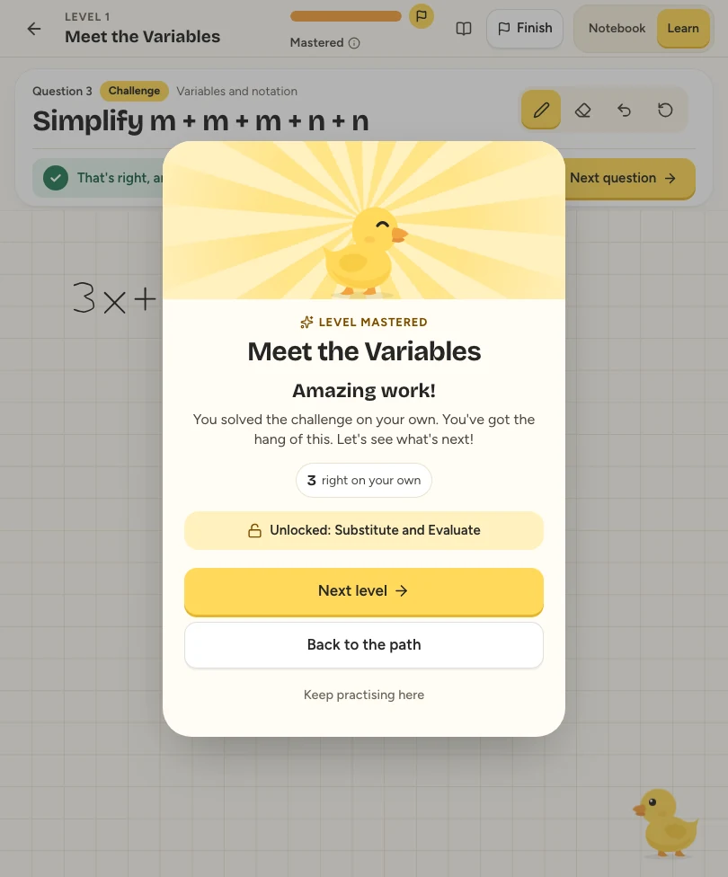

# Meet Quack

These are captures of Quack's actual interface. The ink and test accounts are synthetic, and a local fake Meta server supplies scripted readings. The notebook, API, mathematical verifier and learning flow are real. The images demonstrate product states, not live Meta recognition, physical Apple Pencil accuracy or educational outcomes.

The hero and mascot export use the original SVG duck from `apps/web/components/duck/Duck.tsx`.

| Image | What it shows |
|---|---|
| [Hero](hero.svg) | Quack's original duck, warm cream palette and tagline |
| [Duck](quack.svg) | The original mascot artwork |
| [Six learning paths](learning-paths.webp) | The available course catalog |
| [My Notebook](notebook.webp) | Freeform working and gentle mistake feedback |
| [Guided learning](active-learning.webp) | A question above the reusable handwriting canvas |
| [Mistake feedback](mistake-feedback.webp) | The dropped variable in `3x + 2x = 5` |
| [Helpful hint](mistake-hint.webp) | Requested help on the supported mistake |
| [Verified correction](correction.webp) | The accepted answer `5x` |
| [Algebra roadmap](algebra-roadmap.webp) | Connected levels and progression |
| [Related practice](adaptive-follow-up.webp) | A follow-up on combining like terms |
| [Level Mastered](level-mastered.webp) | The duck's mastery celebration |
| [My Mistakes](my-mistakes.webp) | Corrected and open mistakes in a synthetic account |
| [Welcome](welcome.webp) | The welcome screen and companion |

The product images are full-frame WebP conversions from desktop and tablet-sized browser viewports, with no replacement UI. The reusable synthetic capture driver is `apps/web/tests/e2e/visual.lessons.spec.ts`; screenshots are opt-in as described in [testing](../TESTING.md).
